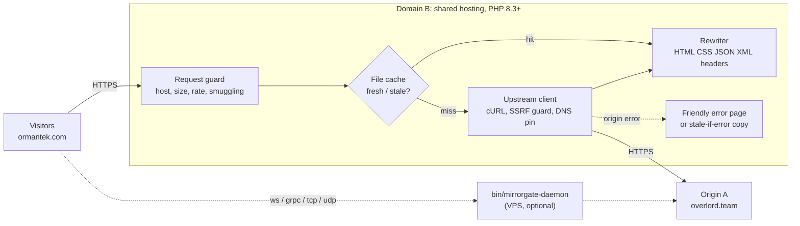
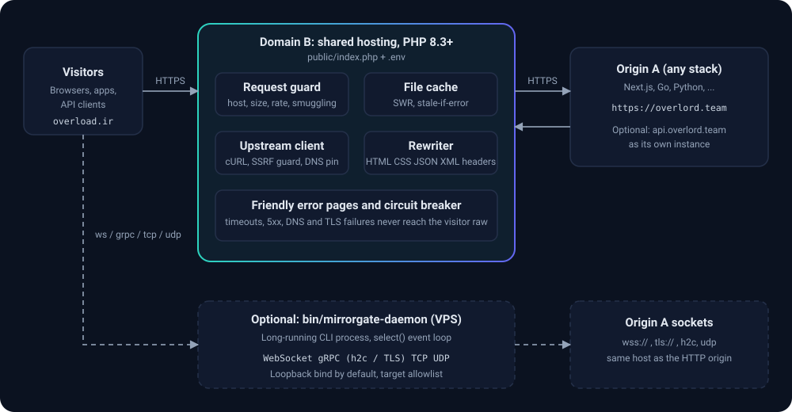
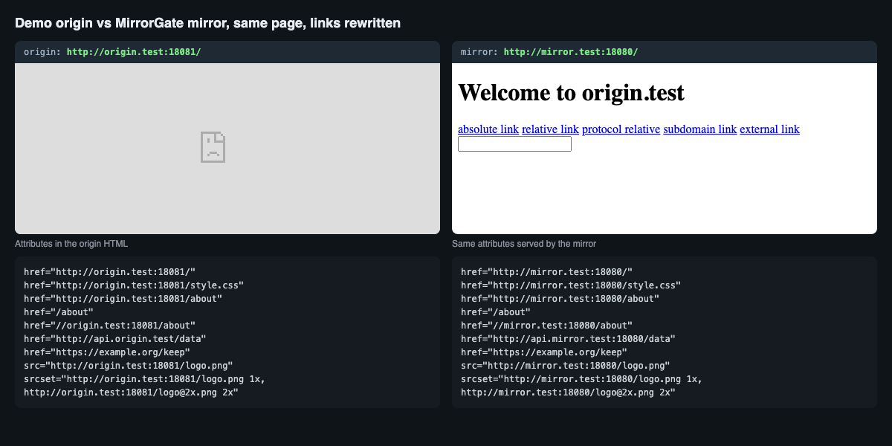
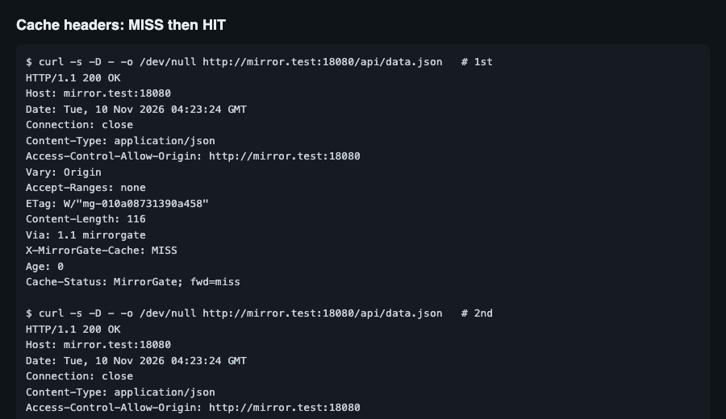
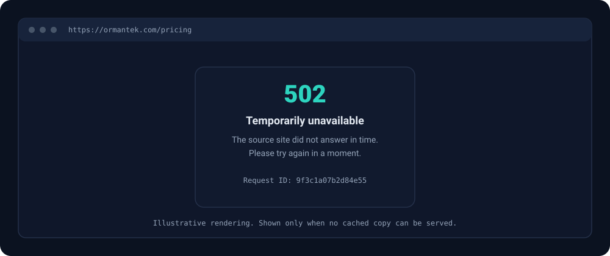
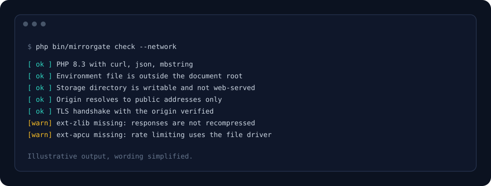

<div align="center">


# MirrorGate

**Mirror any website on your own domain with one PHP app and one `.env` file.**

A zero-dependency reverse-proxy mirror for shared hosting. Upload it, set two URLs, and your domain serves a faithful, cached, rewritten copy of a remote origin, whatever stack that origin runs.

[](LICENSE)
[](https://www.php.net/)
[](https://github.com/moonshadowrev/mirrorgate/releases)
[](https://github.com/moonshadowrev/mirrorgate/stargazers)
[](https://github.com/moonshadowrev/mirrorgate/issues)
[](CONTRIBUTING.md)
[](SECURITY.md)

[Website](https://moonshadowrev.github.io/mirrorgate/) · [Quick start](#quick-start-in-5-steps) · [Configuration](#configuration) · [Security](#security) · [FAQ](#faq)

</div>

---

## Why MirrorGate

You run a site on origin **A** (for example `overlord.team`, a Next.js, Go or Python app). Some visitors cannot reach it reliably, or you need the same site under a second domain **B** (for example `ormantek.com`) hosted on a cheap shared plan that only gives you PHP, FTP and a `.env` file.

Typical answers do not fit that hosting:

- A CDN or Nginx reverse proxy needs DNS control or root access you do not have.
- Copying the site statically breaks every dynamic route and API call.
- Existing PHP proxy scripts are single files with no caching, no hardening and no error handling.

MirrorGate fills that gap. It is a small, auditable PHP application that behaves like a CDN edge node in front of your origin, configured only through environment variables.

## What it does

- **Transparent proxying** of every method you allow, with request bodies, uploads, cookies and conditional requests.
- **Host rewriting** of the origin host to the mirror host in HTML, CSS, JSON, XML, `srcset`, `Link` and `Location` headers, cookies, CORS and CSP headers. JavaScript and RSC rewriting are available as explicit opt-ins.
- **File cache** with `stale-while-revalidate` and `stale-if-error`, request coalescing, size and entry quotas, and an admin purge endpoint.
- **Origin failure handling**: timeouts, connection refused, DNS and TLS errors, 5xx and a per-instance circuit breaker. Visitors get a friendly error page (English or Persian) or a stale cached copy, never a raw stack trace.
- **Server-Sent Events** streaming with bounded duration, heartbeat and concurrency.
- **Optional daemon** (`bin/mirrorgate-daemon`) for WebSocket, gRPC (h2c or TLS pipe), raw TCP and UDP forwarding, for hosts where you can run a long-lived process.
- **Many independent instances**: one per (sub)domain, each with its own docroot, `.env`, cache and limits.

## Architecture





Request lifecycle in short: validate the request, check the cache, fetch from the origin through the SSRF-guarded client when needed, rewrite the response, store it if policy allows, and emit it. If the origin fails and a stale copy exists, the stale copy is served.

## Feature matrix

The honest answer to "does it do X?" depends on where it runs. Classic shared hosting runs PHP only inside short-lived request workers. Anything that needs a long-lived socket requires the daemon on a VPS or another host where you can start a process.

| Capability | Shared hosting (PHP only) | VPS with daemon | Notes |
|---|:---:|:---:|---|
| HTTP and HTTPS reverse proxy | Yes | Yes | GET, HEAD, POST, PUT, PATCH, DELETE, OPTIONS by default |
| Host rewriting in HTML, CSS, JSON, XML | Yes | Yes | Also `srcset`, `Link`, `Location`, cookies, CORS, CSP |
| JavaScript host rewriting | Opt-in | Opt-in | `REWRITE_JS=true`, literal replacement only, no tokenizing |
| File cache, SWR, stale-if-error | Yes | Yes | Quota-limited by your account inodes and disk |
| Friendly error pages, circuit breaker | Yes | Yes | `ERROR_PAGE_LANG=en` or `fa` |
| Server-Sent Events | Best effort | Best effort | Needs a host that does not buffer PHP output; bounded by `SSE_MAX_DURATION` and your PHP worker pool |
| Admin endpoints (health, stats, purge, check) | Yes | Yes | Off by default, bearer token, constant-time compare |
| Rate limiting and concurrency limits | Yes | Yes | File driver, or APCu when available |
| Multiple subdomains | Yes | Yes | One instance per subdomain, see [multi-instance](docs/multi-instance.md) |
| WebSocket | No (answers 501) | Yes | PHP cannot hold the socket; daemon `ws://` listener |
| gRPC | No | Yes | HTTP/2 pipe (h2c or TLS), L4 passthrough, no protobuf handling |
| Raw TCP | No | Yes | `tcp://` to `tcp://` or `tls://` |
| UDP | No | Yes | Session table with TTL and amplification limit |
| Wildcard `*.domain` mirroring | No | No | Explicit `HOST_MAP` and one instance per host instead |
| Composer required at runtime | No | No | Own PSR-4 autoloader and `.env` parser |

## Quick start in 5 steps

You need PHP 8.3 or newer with `ext-curl`, `ext-json` and `ext-mbstring`. No Composer, no shell access required for the web app.

1. **Upload.** Download a release (or clone the repository) and upload the whole project to your hosting account, for example to `~/mirrors/ormantek.com/`.
2. **Point the docroot at `public/`.** In your control panel set the domain's document root to `.../public`. If the panel does not allow that, use the root shim and the self-protecting `.env.php` form described in [`.env.example`](.env.example).
3. **Create `.env`** one directory above `public/`:

   ```bash
   cp .env.example .env
   ```

   ```dotenv
   ORIGIN_URL=https://overlord.team
   MIRROR_URL=https://ormantek.com
   ```

   Only these two values are required. Everything else has a safe default.
4. **Check the setup.** With SSH run `php bin/mirrorgate check --network`. Without SSH set `ADMIN_ENABLED=true` and a random `ADMIN_TOKEN` of at least 32 characters, then call `/__mirrorgate/check` with `Authorization: Bearer <token>`, and turn the admin off again afterwards if you do not need it.
5. **Point DNS and TLS** for the mirror domain at the hosting account (AutoSSL or Let's Encrypt), then open `https://ormantek.com/`.

Local try-out without hosting: `php -S 127.0.0.1:8080 -t public` with a `.env` whose `MIRROR_URL` is `http://127.0.0.1:8080`. Note that the origin must stay `https` unless you set `ORIGIN_ALLOW_HTTP=true`, and a mirror host must not equal or sit under the origin host.

### Several sites on one account

One instance serves exactly one mirror (sub)domain. To mirror `overlord.team` as `ormantek.com` and `api.overlord.team` as `api.ormantek.com`, deploy two instances, each with its own docroot, `.env` and storage directory:

```text
~/mirrors/ormantek.com/       .env  ORIGIN_URL=https://overlord.team
                                   MIRROR_URL=https://ormantek.com
                                   HOST_MAP=api.overlord.team=api.ormantek.com
~/mirrors/api.ormantek.com/   .env  ORIGIN_URL=https://api.overlord.team
                                   MIRROR_URL=https://api.ormantek.com
                                   HOST_MAP=overlord.team=ormantek.com
```

Instances never share cache, locks, rate-limit or breaker state. You can run a full copy per subdomain, or keep one copy of the code and give every subdomain a three-line `index.php` stub that points at its own `.env`. Cross-host links, CORS and cookies need a reciprocal `HOST_MAP` and a deliberate `COOKIE_DOMAIN_MODE`; read [docs/multi-instance.md](docs/multi-instance.md) before you deploy siblings.

## Configuration

Everything is set in `.env`. A process environment variable with the same name overrides the file. [`.env.example`](.env.example) documents every variable with its default; `php bin/mirrorgate config:dump` prints the effective configuration with secrets masked.

| Variable | Default | Purpose |
|---|---|---|
| `ORIGIN_URL` | required | Remote site to mirror, `https://host[:port]` only |
| `MIRROR_URL` | required | Public URL of this mirror; host must differ from the origin |
| `MIRROR_ALIASES` | empty | Extra inbound hostnames treated as this mirror |
| `HOST_MAP` | empty | Sibling mappings such as `api.overlord.team=api.ormantek.com` |
| `STORAGE_DIR` | `<env dir>/var` | Cache, logs, locks, rate-limit state; must be outside the docroot |
| `ORIGIN_CONNECT_TIMEOUT` / `ORIGIN_TIMEOUT` | `5` / `30` s | Connect and total origin timeouts |
| `ORIGIN_RETRIES` | `1` | Retries for safe requests with backoff |
| `MAX_REQUEST_BODY_BYTES` | `10M` | Largest accepted request body |
| `MAX_STREAM_BYTES` | `100M` | Largest streamed response |
| `REWRITE_ENABLED`, `REWRITE_HTML/CSS/JSON/XML` | `true` | Per content type rewriting switches |
| `REWRITE_JS`, `REWRITE_RSC` | `false` | Opt-in rewriting of JavaScript and React Server Components |
| `SEO_MODE` | `mirror` | `mirror`, `canonical-origin` or `noindex` |
| `COOKIE_DOMAIN_MODE` | `drop` | `drop` (host-only cookies) or `rewrite` |
| `CACHE_ENABLED` | `true` | Master switch for the file cache |
| `CACHE_DEFAULT_TTL` | `300` s | Fallback TTL when the origin gives none |
| `CACHE_STALE_IF_ERROR_SECONDS` | `604800` | How long a stale copy may cover an origin failure |
| `CACHE_MAX_BYTES` / `CACHE_MAX_ENTRIES` | `256M` / `20000` | Cache quotas |
| `RATE_LIMIT_REQUESTS` / `RATE_LIMIT_WINDOW` | `120` / `60` s | Per-client request limit |
| `RATE_LIMIT_MAX_CONCURRENT` | `4` | Concurrent requests per client |
| `SSE_ENABLED`, `SSE_MAX_DURATION` | `true`, `60` s | Event stream support and cap |
| `ADMIN_ENABLED`, `ADMIN_TOKEN`, `ADMIN_IP_ALLOW` | `false`, empty | Admin endpoints, off unless enabled |
| `ERROR_PAGE_LANG` | `en` | Built-in error page language, `en` or `fa` |
| `TRUSTED_PROXIES` | empty | CIDRs allowed to set the client IP header |
| `DAEMON_LISTEN_1` ... `DAEMON_LISTEN_32` | empty | Daemon listeners, `ws://127.0.0.1:9001->wss://overlord.team:443` |

### Daemon in one minute

```dotenv
DAEMON_LISTEN_1=ws://127.0.0.1:9001->wss://overlord.team:443
DAEMON_LISTEN_2=tcp://127.0.0.1:9002->tls://overlord.team:443
DAEMON_LISTEN_3=grpc://127.0.0.1:9004->tls://overlord.team:443
WS_PUBLIC_URL=wss://ws.ormantek.com
```

```bash
php bin/mirrorgate-daemon check
php bin/mirrorgate-daemon start          # or --foreground under systemd
```

Put a TLS-terminating reverse proxy in front of the loopback listeners, or bind publicly with `DAEMON_ALLOW_PUBLIC_BIND=true` and understand the exposure. A systemd unit is in [`examples/mirrorgate-daemon.service`](examples/mirrorgate-daemon.service). Targets are restricted to the origin host unless you extend `DAEMON_TARGET_ALLOWLIST`.

## Security

Security is the first design constraint. The summary:

| Threat | Defence |
|---|---|
| SSRF | Upstream URL built only from configuration; every DNS answer validated against private, loopback, link-local and reserved ranges; validated IP pinned with `CURLOPT_RESOLVE`; redirects never followed; http and https only; port allowlist; TLS verification cannot be disabled |
| Host header attacks | Inbound `Host` must match the configured mirror or alias, otherwise `421`; mirror URLs are generated from configuration, never from `Host` or `X-Forwarded-*` |
| Header and CRLF injection | Control characters and invalid header names rejected on input and dropped on ingestion from the origin |
| Request smuggling | `Content-Length` plus `Transfer-Encoding`, duplicate lengths and unsupported encodings rejected; MirrorGate always sends its own length upstream |
| Cache poisoning | Cache key built from normalized path, query and `Vary` rules; requests carrying cookies only hit the cache for static extensions (`CACHE_COOKIE_MODE=static-only`); cache files addressed by sha256 hashes |
| Open redirect | `Location` rewritten against a strict host map; leading `//` collapsed; external redirects follow `REDIRECT_EXTERNAL` |
| XSS via rewriting | Rewriting replaces host literals only and never injects markup; `Content-Type`, charset and CSP handled explicitly (`CSP_MODE=rewrite`); service worker handling is configurable with `SERVICE_WORKER_MODE` (`passthrough` by default, `rewrite` or `block` available) |
| Path traversal | Dot segments, encoded slashes, backslashes and NUL rejected; cache files addressed by hash, not by path |
| Admin abuse | Off by default; bearer token of at least 32 random characters; constant-time comparison; per-IP and global failure lockout; optional IP allowlist; unauthenticated callers cannot tell a real path from a missing one |
| DoS | Limits on body size, URL length, header count and size, redirects, timeouts, concurrency, stream bytes and rate; per-origin fetch budget; circuit breaker |
| Information leakage | `.env` must live outside the docroot or use the self-protecting `.env.php` form, otherwise boot fails closed; error pages and admin output never contain the origin address, paths or stack traces; query strings are never logged |

A residual-risk note: MirrorGate cannot protect visitors from a malicious origin. It proxies whatever origin A serves. Only mirror sites you control or trust, and review the legal position for third-party content. To report a vulnerability, follow [SECURITY.md](SECURITY.md); please do not open a public issue.

## Screenshots

Captures from the bundled demo origin and test harness.

| | |
|---|---|
|  |  |
| Same page on origin and mirror, every host literal rewritten. | `X-MirrorGate-Cache` and `Cache-Status` on a first and second request. |

Illustrations of the error page and the setup check (not live captures):

| | |
|---|---|
|  |  |

## FAQ

**Is this legal?** MirrorGate is a tool. Mirroring a site you do not own or have permission for may violate copyright, terms of service or local law. Use it for your own properties, for sites that permit mirroring, or for resilience in front of an origin you operate.

**Will it work with Next.js, Go, Python and others?** It speaks HTTP and rewrites hosts in common formats, so the origin stack does not matter. Apps that hard-code absolute origin URLs in bundles need `REWRITE_JS=true`; apps that serialize hosts inside React Server Component payloads are a known hard case, see limitations.

**Can I log in through the mirror?** Cookies are forwarded and rewritten, and `FORWARD_AUTHORIZATION` is on by default. Be aware that anyone who operates the mirror can read what passes through it. Do not use a mirror you do not control for credentials.

**Does it hide that my origin exists?** It does not claim to. Origin internals are not leaked in headers or error pages, but the origin hostname appears in DNS history, certificates and anything the origin itself embeds.

**Why not just use Cloudflare or Nginx?** If you control DNS or a server, use them; they are better at this. MirrorGate is for accounts where PHP and a file manager are all you have.

**How do I clear the cache?** `php bin/mirrorgate purge --all`, `--prefix=/blog` or `--url=/path`, or the authenticated admin purge endpoint.

**Does it need Composer?** No. `composer.json` exists for tooling and dev dependencies (PHPStan, PHPUnit) only. Production needs no `vendor/` directory.

**Which PHP versions?** 8.3 minimum, written to run clean on 8.4 and 8.5 (no deprecated APIs, no dynamic properties, explicit nullable types).

## Limitations

- WebSocket, gRPC, raw TCP and UDP cannot run inside php-fpm. They need `bin/mirrorgate-daemon` on a host that allows a long-lived process.
- SSE holds one PHP worker per open stream and is capped. Hosts that buffer output (some LiteSpeed and proxy setups) will delay events.
- No wildcard subdomain mirroring. Each host is its own instance with an explicit `HOST_MAP`.
- Prefix mode merges several origin hosts into one browser origin (shared cookies and storage) and needs an explicit acknowledgement.
- JavaScript rewriting is literal host replacement, not a parser. Obfuscated or computed hosts are not rewritten.
- React Server Component streams use length-prefixed rows and are not rewritten by default.
- Cache size is bounded by your account's disk quota and inode limit.
- Request smuggling checks only see what the web server exposes to PHP.
- Not a WAF and not an anonymizer. It does not hide the visitor's or the operator's identity.

## Roadmap

Direction, not promises:

- Tagged releases with a prebuilt upload archive and checksums.
- Optional Redis or SQLite cache backend for hosts that offer them.
- Cache tags and targeted purge by origin response header.
- Improved Next.js and RSC payload handling.
- Built-in test origin and one-command demo.
- More error page languages.

Ideas and pull requests are welcome; open an issue first for anything large.

## Development

```bash
composer install            # dev tools only
composer test               # PHPUnit
composer check              # lint, PHPStan, tests
php tests/run.php           # standalone runner, no Composer needed
composer stan               # PHPStan level 8
composer e2e                # demo origin + mirror, asserted with curl
```

## Contributing

Read [CONTRIBUTING.md](CONTRIBUTING.md). Keep the zero-runtime-dependency rule, add a test for every behaviour change, and never commit secrets.

## License

Apache License 2.0. See [LICENSE](LICENSE).
